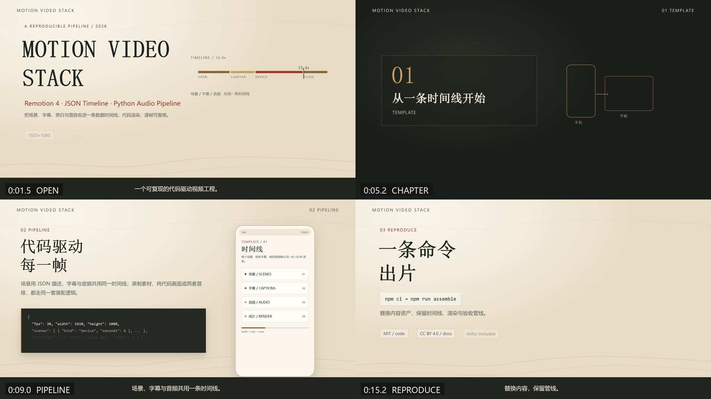
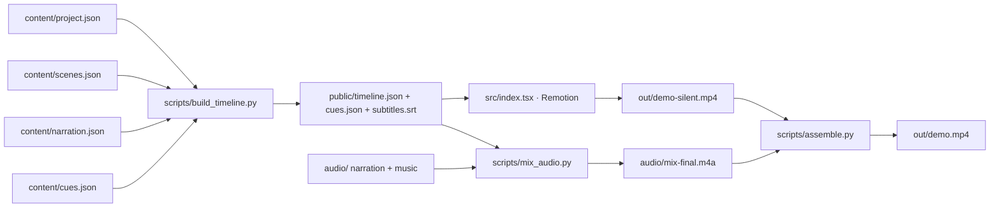

# Motion Video Stack

一套可复现的、代码驱动的动效视频技术栈：**Remotion 渲染 + JSON 时间线 + Python 音频管线 + 导演/验收 Skills**。

仓库只放技术栈与通用模板，**不含任何项目录屏、旁白、音乐或成片**。下面这支 16 秒示例完全由本仓库的代码与通用文案生成，用来证明管线能跑通。



## 它解决什么

- **时间线是唯一真相源**：场景、字幕、旁白、混音共用同一组秒数与帧号，改一处不会各自漂移。
- **内容是数据**：场景、文案、音频位置都写在 `content/*.json`，替换内容不需要改组件。
- **先导演后代码**：skills 把 brief → 运动论题 → beat graph → 运动语言 → 镜头 → 逐时码验收固化下来。
- **可验证**：`ffprobe`、`ebur128`、抽帧命令和验收 rubric 都在仓库里，不靠“看起来没问题”。

## 不是什么

- 不是开箱即用的成片模板。示例只演示管线；视觉必须按你的 brief 重做。
- 不包含 Remotion 的商业授权。Remotion 不是 MIT，许可见 [NOTICE.md](NOTICE.md)。
- 不包含没有许可证的第三方 skills；安装脚本按固定 commit 从上游拉取。

## 环境要求

| 依赖 | 版本 / 说明 |
| --- | --- |
| Node.js | ≥ 20（本项目使用 22 LTS） |
| Python | ≥ 3.10（只用标准库） |
| FFmpeg | 建议 7+，需要 `ffmpeg` / `ffprobe` 在 PATH |
| Chrome/Chromium | Remotion 会自行下载；也可用 `REMOTION_BROWSER` 指定 |
| 字体 | Windows：SimSun + Microsoft YaHei；macOS：Songti SC + PingFang SC；Linux：Noto Serif/Sans CJK |

## 快速开始

```bash
git clone https://github.com/Yenefa/motion-video-stack.git
cd motion-video-stack
npm ci

# 1) 从 content/ 生成 public/timeline.json、cues.json、subtitles.srt
npm run timeline

# 2) 渲染 + 混音 + 封装；没有音频时自动输出无声片
npm run assemble
```

产物：`out/demo.mp4`（1920×1080 / 30fps / 16s）。

只想预览或只渲染静音母版：

```bash
npm run studio        # Remotion Studio
npm run render        # out/demo-silent.mp4，不含音频
```

如果 Remotion 下载浏览器失败，指定本机 Chrome：

```bash
# macOS
REMOTION_BROWSER="/Applications/Google Chrome.app/Contents/MacOS/Google Chrome" npm run assemble
# Windows PowerShell
$env:REMOTION_BROWSER="C:\Program Files\Google\Chrome\Application\chrome.exe"; npm run assemble
# Linux
REMOTION_BROWSER=/usr/bin/google-chrome npm run assemble
```

## 数据流



- `build_timeline.py` 只读秒数、时长与文本，不读图片/视频。
- Remotion 只消费 `public/timeline.json` 与 `cues.json`，组件里不写死时间。
- `mix_audio.py` 用 `adelay` 按时间线落旁白，用一次静态增益对齐目标响度，不用 `loudnorm`（它会像 AGC 一样压动态）。
- `assemble.py` 负责把静音母版和终混封装到一起。

## 目录

```text
content/            可编辑源：project / scenes / narration / cues
public/             编译产物 timeline.json / cues.json / subtitles.srt
src/
  index.tsx         合成入口、场景路由、示例场景
  components.tsx    Paper / Title / Caption / ChapterCard / PhoneFrame / RiverLine
  theme.ts          色板、字体栈、缓动与入场函数
scripts/
  build_timeline.py 校验秒数与帧数、生成时间线/字幕
  mix_audio.py      旁白 + 音乐 → -17 LUFS 终混
  assemble.py       render → mix → mux，一条命令出片
  install_skills.py 按 commit 安装上游 skills
skills/             已入库的导演/美术/镜头 skills + manifest
docs/               栈说明、工作流、时间线、音频、QC、方向包模板
out/                渲染产物（不入库）
```

## 技术栈

| 层 | 选择 | 作用 |
| --- | --- | --- |
| 合成/渲染 | [Remotion 4.0.540](https://www.remotion.dev/) | React 组件逐帧渲染，`--muted` 出静音母版 |
| UI | React 19.2 + TypeScript/TSX | 组件、样式、SVG 全部代码化 |
| 时间线 | JSON + Python 3.11 | 场景/字幕/旁白共用秒数，自动换算帧号 |
| 音频 | FFmpeg 9 + `ebur128` | 旁白落位、音乐衰减、静态增益、真峰值限制 |
| 验收 | `ffprobe` + 抽帧 + rubric | 规格、解码、响度、字幕遮挡逐项留证 |
| 导演 | skills/ | brief、beat graph、运动语言、镜头卡、逐时码 review |

## 时间线

`content/scenes.json` 是有序数组，每项最少包含：

```json
{ "id": "open", "kind": "opening", "seconds": 4, "title": "…", "chapter": "", "details": [] }
```

`build_timeline.py` 会：

1. 按 `fps` 把每场秒数换算成帧数，累计出 `start`；
2. 校验总秒数与 `content/project.json` 的 `expected_seconds` 一致；
3. 读取 `content/narration.json`，缺时长时用 `ffprobe` 测量，检查重叠与越界；
4. 校验字幕时间范围、行数，并输出 SRT。

更完整的 schema、扩展场景类型和添加真实录屏的方法见 [docs/timeline.md](docs/timeline.md)。

## 音频（可选）

示例时间线没有旁白和音乐，`mix_audio.py` 会直接跳过，`assemble.py` 输出无声片。要接入音频：

1. 把旁白放在 `audio/`，在 `content/narration.json` 写 `{ "id", "file", "start" }`；
2. 可选在 `content/project.json` 的 `music` 写音乐路径（相对仓库根目录）；
3. 重新 `npm run timeline`，再 `npm run assemble`。

混音策略、目标响度、原生音频静音窗口和环境变量见 [docs/audio.md](docs/audio.md)。

## 添加真实录屏

模板本身不依赖任何媒体；需要真机录屏时，用 `@remotion/media` 的 `Video` 在场景里挂载即可：

```tsx
import {Video} from '@remotion/media';
import {staticFile, useCurrentFrame} from 'remotion';

const Clip: React.FC<{clip: string}> = ({clip}) => {
  const f = useCurrentFrame();
  return (
    <Video
      src={staticFile(`clips/${clip}.mp4`)}
      startFrom={Math.round(f)}
      style={{position: 'absolute', inset: 0, width: '100%', height: '100%', objectFit: 'cover'}}
    />
  );
};
```

把文件放到 `public/clips/`，在 `timeline.json` 的场景里加 `clip` 字段，再在 `SceneView` 路由到 `Clip`。真实录屏属于内容资产，**不要提交到本仓库**；用你自己的仓库或对象存储。

## Skills

| Skill | 作用 | 许可 |
| --- | --- | --- |
| `motion-video-director` | 六阶段导演流程、beat graph、验收 rubric | MIT（本仓库原创） |
| `motion-art-direction` | 运动语言、节奏、克制与一致性 | MIT |
| `video-shotcraft` | 124 张镜头配方卡与参考实现 | Apache-2.0 |
| `ai-motion-director` | 运动论题、anti-PPT 门禁 | 上游无 LICENSE，不随仓库分发 |
| `remotion-*` | Remotion 路由/新建/渲染/Studio | 上游无 LICENSE，不随仓库分发 |

安装上游-only 的 skills：

```bash
python scripts/install_skills.py           # 到 skills/upstream/
python scripts/install_skills.py --global  # 同时安装到 ~/.qoder-cn/skills
```

完整清单、pin 的 commit 与调用顺序见 [skills/README.md](skills/README.md)。

## 复现检查

```bash
# 规格 + 帧数
ffprobe -v error -show_entries stream=codec_type,width,height,r_frame_rate,nb_frames,duration \
  -show_entries format=duration,size -of default=nw=1 out/demo.mp4

# 完整解码
ffmpeg -v error -i out/demo.mp4 -f null -

# 终混响度 / 真峰值（有音频时）
ffmpeg -hide_banner -nostats -i out/demo.mp4 -map 0:a:0 -af ebur128=peak=true -f null -
```

抽帧、字幕遮挡与时间码检查见 [docs/qc.md](docs/qc.md)；验收模板见
[skills/director-workflow/references/acceptance-rubric.md](skills/director-workflow/references/acceptance-rubric.md)。

## 字体与排版

不同系统的宋体/黑体度量不同，换行会变。模板优先使用 Windows 字体，同时提供
macOS 与 Noto CJK 回退；Linux 上请安装 `fonts-noto-cjk`，并在渲染后抽帧检查标题
是否出现孤字或溢出。字体不是本仓库的资产，许可见 [NOTICE.md](NOTICE.md)。

## 许可证

- 代码、脚本、模板：**MIT**，见 [LICENSE](LICENSE)。
- 文档、示例时间线、渲染出的示例：**CC BY 4.0**，见 [LICENSE-DOCS](LICENSE-DOCS)。
- 各 skill 保留自己的许可证；Remotion、字体、FFmpeg 的条款见 [NOTICE.md](NOTICE.md)。

## 来源说明

本仓库脱胎于一次 1080p 参赛演示片的工程实践，但已移除全部项目内容与媒体资产，
只保留可复用的管线、模板与方法。它是技术栈，不是那次项目的档案。
